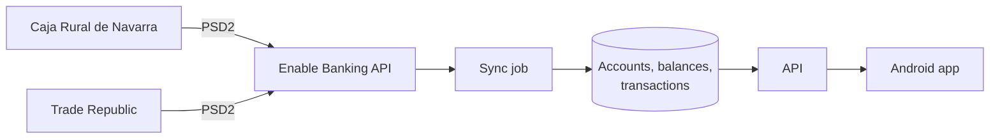

# Finances Hub

A personal, **read-only** finance monitor for Android. It brings together my two banks — **Caja Rural de Navarra**
and **Trade Republic** — so I can see in one place how much money I have and what moves in each account.

Built as a portfolio project with **.NET 10, Aspire, Flutter, Azure SQL and Azure Container Apps**. It's for my own
use: the app is installed as an APK on my phone and isn't published on any store.

> **Status: in development.** The solution is scaffolded; the features below are being built.

## What it does

- **Total balance**: all my money across both banks, in one figure.
- **Balance per bank**: what's in Caja Rural de Navarra and what's in Trade Republic.
- **Transactions per account**: every movement of each account, newest first, with filters by date and by
  income or expense.
- **Read-only**: the app never moves money. It only asks the banks for read access to account information (PSD2
  AIS); payments are never requested.
- **Demo mode**: a fake bank provider, so the app can be run and shown without any real bank account.

## Where the data comes from

Both banks are read through the **[Enable Banking](https://enablebanking.com) API**, an aggregator of the banks'
PSD2 APIs. It runs in *restricted production mode*: only accounts I link myself can be read, for individual,
non-commercial use.



### Enable Banking calls

| Call | What for |
|---|---|
| `GET /aspsps` | Find each bank and how long its consent can last |
| `POST /auth` | Start linking a bank: returns the bank's login page |
| `POST /sessions` | After the login, exchange the code for a session with the account IDs |
| `GET /sessions/{id}` | Check the session is still authorised and when it expires |
| `GET /accounts/{id}/details` | IBAN, account name, currency, product |
| `GET /accounts/{id}/balances` | Current balances (booked, available) |
| `GET /accounts/{id}/transactions` | Transactions by date range, paged with `continuation_key` |

Calls are authenticated with a JWT (RS256) signed by the application's private key, which lives in Key Vault and
never in the repo.

### What each bank gives

| | Caja Rural de Navarra | Trade Republic |
|---|---|---|
| Balance | ✅ | ✅ (cash account) |
| Amount, currency, booking date | ✅ | ✅ |
| Description, counterparty, value date… | ✅ (as far as the bank sends them) | ❌ Its PSD2 API gives only amount, currency and booking date |

Trade Republic is listed under Germany in Enable Banking, the country of its banking licence. Investments aren't
covered by PSD2 and are out of scope for now.

### Constraints the design lives with

- **Consents expire.** A consent lasts at most what the bank allows (usually 180 days), so the app warns before it
  expires and has a flow to reconnect.
- **Few background requests.** Many banks allow about 4 background requests a day, so the data is synced by a
  scheduled job a few times a day, not on every app open.
- **Short history.** Many banks give more than 90 days of history only right after the account is linked, so the
  full history is loaded at that moment.

## Architecture


The backend follows a light **Clean Architecture**, like [Plumy](https://github.com/chelomama-dev/plumy): `Domain`,
`Application`, `Infrastructure` (EF Core, Enable Banking client) and two hosts, `Api` and `Sync`. Locally,
**Aspire** starts SQL Server, the API and the sync with one command. The Flutter app runs on an emulator or the phone
and points to the local API.

## Tech stack

| Area | Choice |
|---|---|
| Mobile app | Flutter (Android) |
| Backend | .NET 10, ASP.NET Core minimal APIs, EF Core 10 |
| Data | Azure SQL Database, free offer (SQL Server in a container locally) |
| Bank data | Enable Banking API (PSD2 account information) |
| Auth | Microsoft Entra ID (MSAL in the app, JWT bearer in the API) |
| Hosting | Azure Container Apps (API) and Container Apps Jobs (sync), scale to zero |
| Secrets | Azure Key Vault, managed identities |
| IaC / CI/CD | Bicep, GitHub Actions, GHCR; the APK is built in CI and published as a release |
| Observability | OpenTelemetry, Application Insights |
| Local dev | Aspire 13, Docker |

## Repository layout

```
src/
  FinancesHub.Domain/          accounts, balances, transactions
  FinancesHub.Application/     use cases
  FinancesHub.Infrastructure/  EF Core, Enable Banking client
  FinancesHub.Api/             HTTP API for the app
  FinancesHub.Sync/            pulls balances and transactions from the banks, then exits
  FinancesHub.AppHost/         Aspire orchestration for local dev
  FinancesHub.ServiceDefaults/ OpenTelemetry, health checks, resilience
tests/                         backend tests (coming)
docs/api.md                    HTTP contract between the API and the app
docs/adr/                      architecture decision records
mobile/                        Flutter app (see mobile/README.md)
```

## Run it locally

Requires the .NET 10 SDK, Docker and the Aspire CLI, and an Enable Banking application (its ID and its private key
as a `.pem` file outside the repo). Give them to the AppHost once, as user secrets:

```bash
dotnet user-secrets --project src/FinancesHub.AppHost set "Parameters:enablebanking-application-id" "<application id>"
dotnet user-secrets --project src/FinancesHub.AppHost set "Parameters:enablebanking-private-key-path" "$HOME/.secrets/enablebanking/<application id>.pem"
dotnet user-secrets --project src/FinancesHub.AppHost set "Parameters:enablebanking-redirect-url" "https://localhost:7017/api/connections/callback"
# Comma-separated IBANs that may be stored; empty to store every account you share
dotnet user-secrets --project src/FinancesHub.AppHost set "Parameters:bank-linking-allowed-ibans" "<IBAN>,<IBAN>"
```

Then:

```bash
aspire run
```

The API brings the database up to date on startup, and the sync runs once and exits; restart it from the dashboard
to sync again. To link a bank, `POST https://localhost:7017/api/connections` with `{ "bank": "caja-rural-navarra" }`
(or `trade-republic`), open the `authorizationUrl` and log in to the bank; the browser ends on a local results page
instead of the app's `financeshub://` link. Against Azure, the app links and reconnects banks itself from Conexiones.
Tests need Docker too: the persistence tests run against SQL Server in a container.

## Cost

Built to cost close to nothing: Container Apps on the consumption plan (scales to zero, within the monthly free
grant), the Azure SQL Database free offer (pauses when idle) and images in GitHub Container Registry. The price is a
cold start: the first request after a while takes a few seconds.

## Roadmap

1. ~~**Spike**: link both banks in Enable Banking and make the first real calls.~~ Done: see
   [ADR 0001](docs/adr/0001-sync-replaces-a-recent-window-of-transactions.md).
2. **MVP, local**: sync from Enable Banking into SQL; total balance, balance per bank and transactions in the app.
3. **Azure**: Bicep, GitHub Actions, Entra ID and the APK as a GitHub release.
4. **Later**: statistics (income and expenses by month, categories) and, maybe, Trade Republic investments.

## Disclaimer

A personal project, not affiliated with Caja Rural de Navarra, Trade Republic or Enable Banking. It only reads data
from my own accounts. Screenshots and the demo mode use made-up data.
