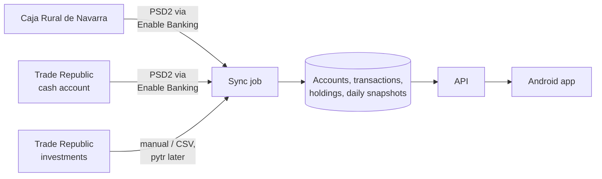
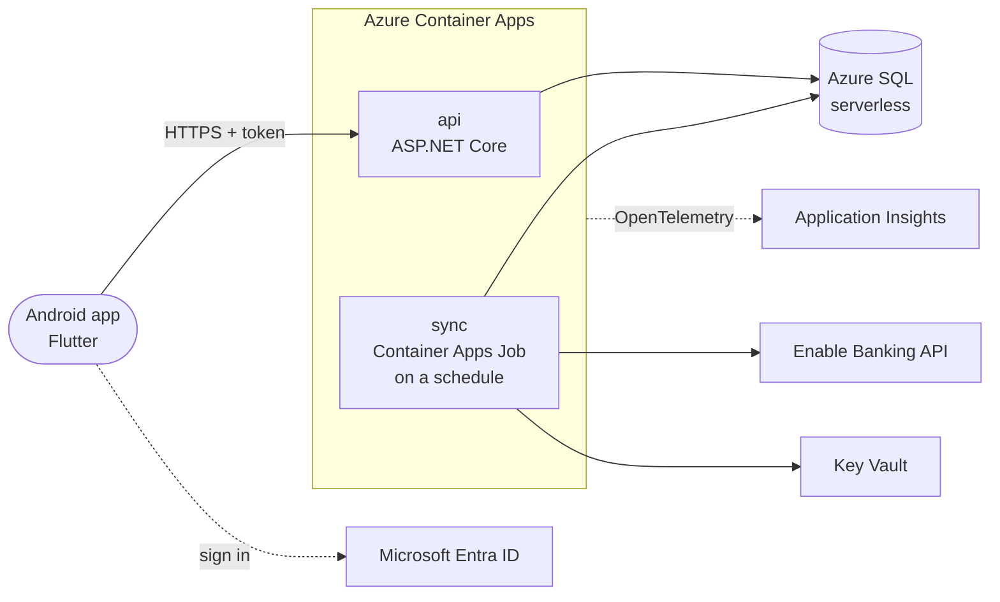

# Finances Hub

A personal, **read-only** finance monitor for Android. It brings together my two banks — **Caja Rural de Navarra**
and **Trade Republic** — so I can see in one place how much money I have, where it goes and how my investments are
doing.

Built as a portfolio project with **.NET 10, Aspire, Flutter, Azure SQL and Azure Container Apps**. It's for my own
use: the app is installed as an APK on my phone and isn't published on any store.

> **Status: planning.** This README describes what's being built. Each section will be updated as features land.

## What it does

- **Total balance**: the money in both banks plus the value of the investments, in one figure.
- **Transactions**: every movement from both banks in one list, with search and filters.
- **Investments**: positions in Trade Republic, their current value, gains and asset allocation.
- **Statistics**: net worth over time, income and expenses by month, spending by category and savings rate.
- **Categories**: transactions are categorised with rules first and a language model only when no rule matches
  (planned).
- **Read-only**: the app never moves money or places orders. It only asks the banks for read access (PSD2 account
  information).
- **Demo mode**: a fake data provider, so the app can be run and shown without any real bank account.

## Where the data comes from

| Source | How | Notes |
|---|---|---|
| Caja Rural de Navarra | [Enable Banking](https://enablebanking.com) API (PSD2 account information) | Restricted production mode: only my own linked accounts, for individual non-commercial use |
| Trade Republic — cash account | Enable Banking API (listed under Germany) | The bank's PSD2 API only gives amount, currency and booking date, without a description |
| Trade Republic — investments | Manual entry / CSV import first; [pytr](https://github.com/pytr-org/pytr) later, optional | Trade Republic has no public API. pytr is unofficial and can break at any time |
| Market prices | A free market data API | To value the positions each day |

Things the design has to live with:

- **Consents expire.** A bank's consent lasts at most what the bank allows (usually 180 days), so the app warns
  before it expires and has a flow to reconnect.
- **Few background requests.** Many banks allow only ~4 background requests per day, so the data is synced by a
  scheduled job a few times a day, not in real time.
- **Short history.** Many banks give more than 90 days of history only right after the account is linked, so the
  full history is loaded at that moment.
- **No net worth history from the banks.** The app stores a snapshot of the net worth every day; that is what the
  charts are built on.

Every source sits behind the same interface, so a source that breaks (or a CSV import that replaces it) doesn't
affect the rest of the app.

## Architecture

Locally, **Aspire** starts everything with one command: SQL Server, the API and the sync job. The Flutter app runs
on an emulator or the phone and points to the local API.

## Tech stack

| Area | Choice |
|---|---|
| Mobile app | Flutter (Android), `fl_chart` |
| Backend | .NET 10, ASP.NET Core minimal APIs, EF Core 10 |
| Data | Azure SQL Database, free offer (SQL Server in a container locally) |
| Bank data | Enable Banking API (PSD2) |
| Auth | Microsoft Entra ID (MSAL in the app, JWT bearer in the API) |
| Hosting | Azure Container Apps (API) and Container Apps Jobs (sync), scale to zero |
| Secrets | Azure Key Vault, managed identities |
| IaC / CI/CD | Bicep, GitHub Actions, GHCR; the APK is built in CI and published as a release |
| Observability | OpenTelemetry, Application Insights |
| Local dev | Aspire 13, Docker |

## Cost

Built to cost close to nothing: Container Apps on the consumption plan (scales to zero, within the monthly free
grant), the Azure SQL Database free offer (pauses when idle) and images in GitHub Container Registry. The price is a
cold start: the first request after a while takes a few seconds.

## Roadmap

1. **Spike**: link my accounts in Enable Banking and make the first real calls.
2. **MVP, local**: Aspire, API, SQL, sync from Enable Banking; total balance and transactions in the app.
3. **Azure**: Bicep, GitHub Actions, Entra ID and the APK as a GitHub release.
4. **Investments**: manual positions with automatic prices, then pytr.
5. **Statistics and categories**: charts, and categorisation with rules plus a language model.

## Disclaimer

A personal project, not affiliated with Caja Rural de Navarra, Trade Republic or Enable Banking. It only reads data
from my own accounts. Screenshots and the demo mode use made-up data.
